# Vertiport Surface Planner

Draw a vertiport or heliport's protected areas on a map in a few minutes, using the FAA's new draft design standard. Export the result to Google Earth or GIS.

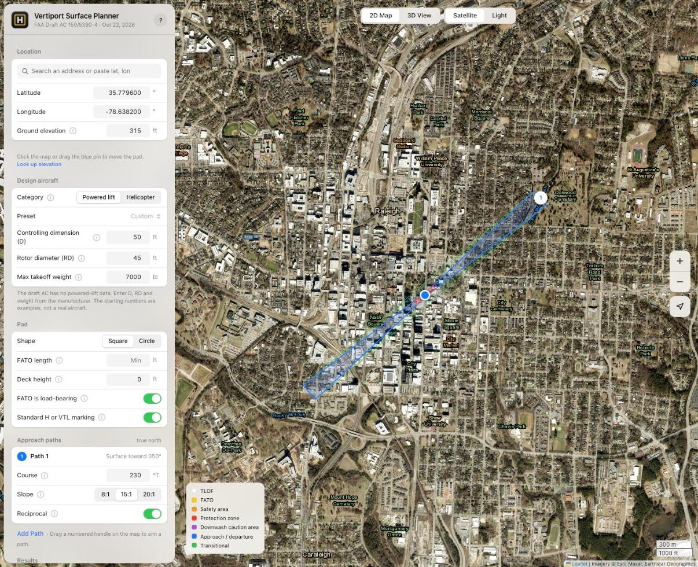

The examples in this guide use a site in Winston-Salem, North Carolina, 1.6 miles west of Smith Reynolds Airport, with two one-way approach paths. The sample exports are in [`docs/examples`](docs/examples).

The planner follows FAA Draft Advisory Circular 150/5390-4, *Vertical Flight Aircraft Infrastructure Design*, posted October 22, 2026. You give it a location, an aircraft and the directions aircraft will arrive from. It works out the size of the landing pad and its safety areas, and draws the sloped approach surfaces that must stay clear of obstacles.

It runs in a web browser. There is nothing to install and no account to create.

The FAA is taking comments on the draft until January 11, 2027 (vertiports@faa.gov). This tool will need updating when the final version is published.

## Open the planner

**Online (recommended):** go to https://basilbuildsai.github.io/vertiport-surface-planner/ in Chrome, Edge, Safari or Firefox. Everything works, including the 3D view.

**From a downloaded copy:** on this GitHub page, click the green **Code** button, then **Download ZIP**. Unzip it, open the `tool` folder, and double-click `vertiport-surfaces.html`. The map, the measurements and the exports all work this way. The 3D view does not, because browsers restrict it for files opened from your computer; use the online link for 3D.

The planner needs an internet connection for maps and elevation data. If a map stays blank on an agency network, see [If something doesn't work](#if-something-doesnt-work).

## Use it in five steps

The first time you open the planner, a Getting Started card walks through these steps. You can reopen it anytime with the **?** button at the top of the sidebar.

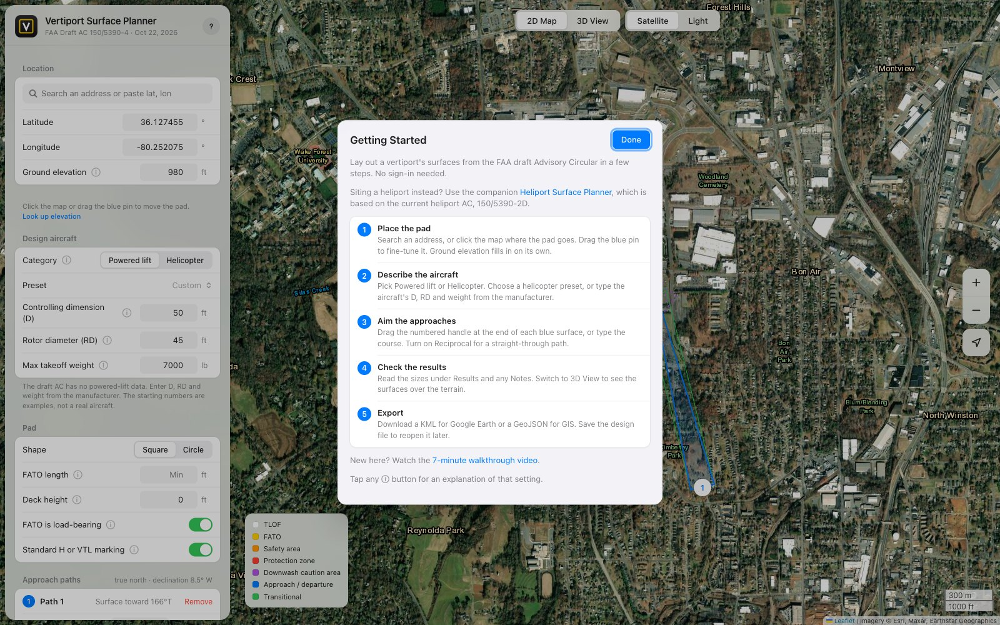

### 1. Place the pad

Type an address in the search box, or paste coordinates such as `35.7796, -78.6382`. You can also click anywhere on the map. Drag the blue pin to fine-tune the spot. The ground elevation fills in on its own from the U.S. Geological Survey.

### 2. Describe the aircraft

Choose **Powered lift** for eVTOL air taxis, or **Helicopter**. For helicopters, pick a model from the Preset list. For powered lift, type three numbers from the aircraft manufacturer:

- **Controlling dimension (D):** the width of the smallest circle that fits around the whole aircraft, seen from above.
- **Rotor diameter (RD):** the width of the smallest circle around all the rotors or propellers.
- **Max takeoff weight:** in pounds.

The draft AC has no data for powered-lift aircraft, so these numbers must come from the manufacturer. The starting values in the planner are examples only.

### 3. Aim the approaches

Each blue band is an approach path. Drag the numbered white handle at its end to point it where aircraft will fly in, or type the course in degrees from true north. Pick a slope; powered lift needs 15:1 or flatter. Leave **Reciprocal** on if aircraft can use the same line in both directions. Use **Add Path** for another direction.

### 4. Check the results

The **Results** section lists every size the AC requires, and **Notes** flags anything that needs attention, such as a slope that is too steep for the aircraft type.

Every setting and result has a small **ⓘ** button. Click it for a plain-language explanation and the AC paragraph it comes from.

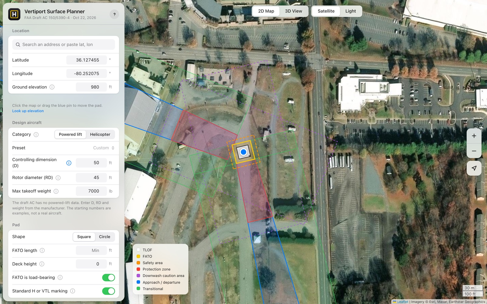

### 5. Export

Name the site, then click **Google Earth (KML)** or **GIS (GeoJSON)**. The file saves to your Downloads folder. Click **Save** under Design file to keep your settings, and **Open** to load them again later or share them with a colleague.

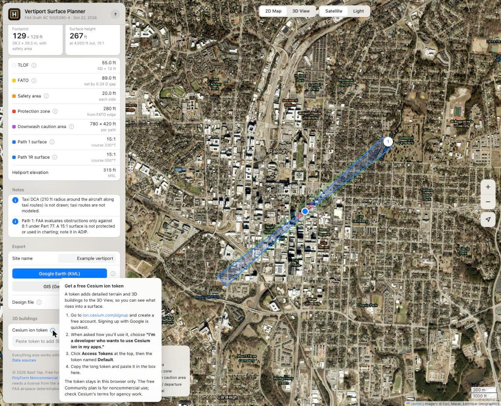

## See it in 3D

Click **3D View** at the top of the map. The surfaces appear in the air at their real heights over the terrain. Use the buttons on the right to zoom, rotate and tilt, and the bar at the bottom for preset views. On a laptop trackpad, drag to move and pinch to zoom.

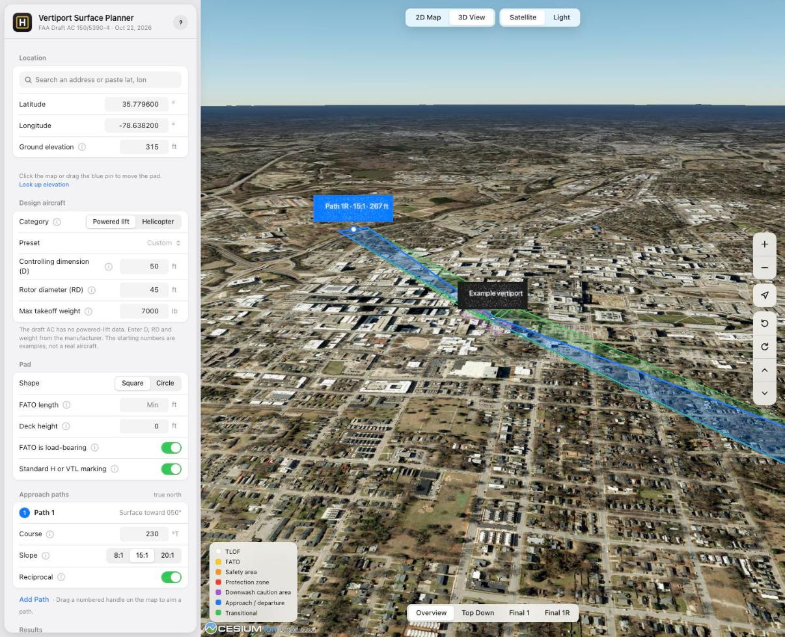

Click **Light** at the top for a plain gray map that makes the surfaces easier to read.

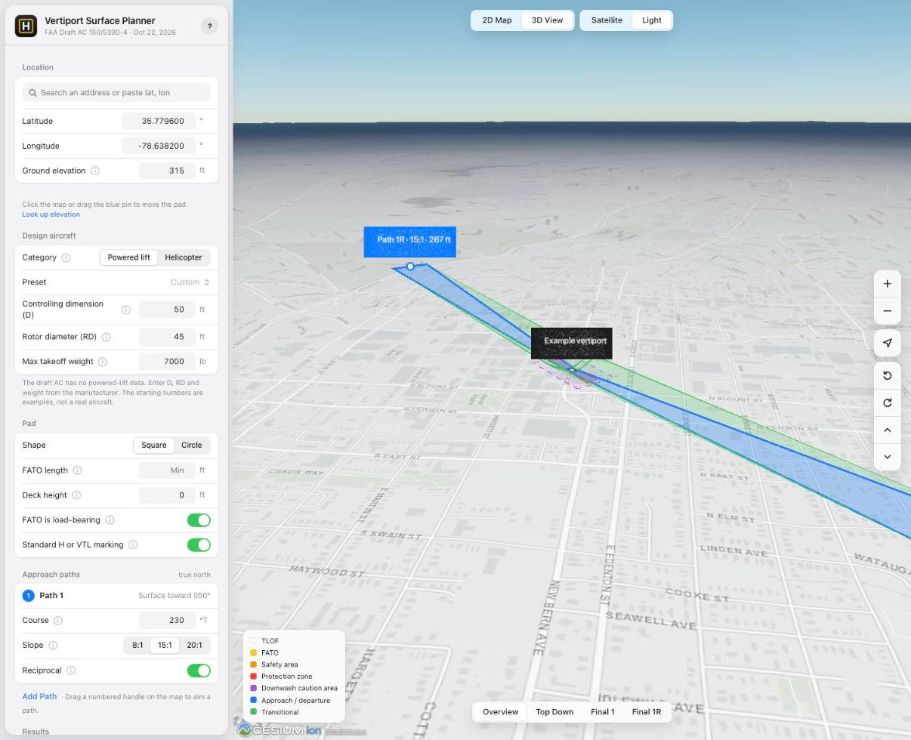

### Optional: show 3D buildings

To see which buildings rise into an approach surface, add a free Cesium ion token. Click the **ⓘ** next to "Cesium ion token" in the sidebar for these same steps:

1. Go to https://ion.cesium.com/signup and create a free account. Signing up with Google is quickest.
2. When asked how you'll use it, choose "I'm a developer who wants to use Cesium ion in my apps."
3. Click **Access Tokens** at the top of the page, then the token named **Default**.
4. Copy the long token and paste it into the **Cesium ion token** box in the planner.

With a token, buildings appear in gray and you can see which ones rise through a surface. In this example, the Wake Forest University stadiums sit just beside the approach surfaces.

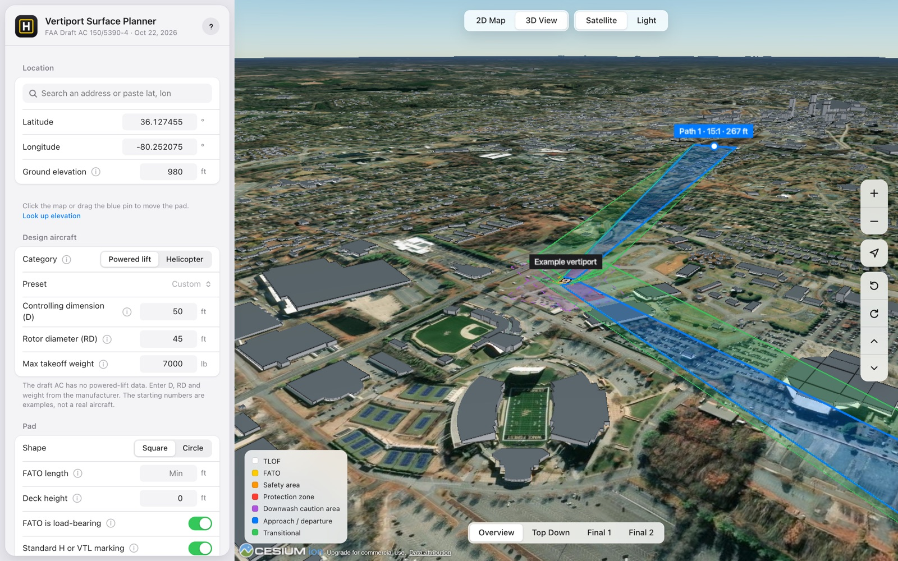

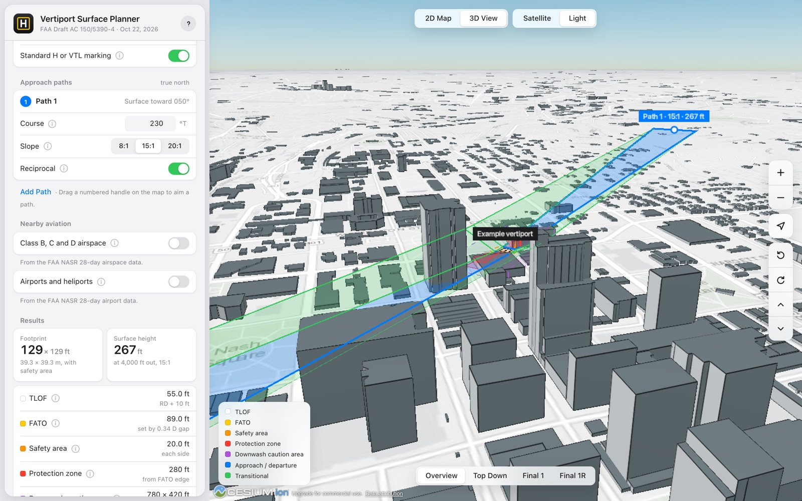

The token is saved only in your browser. Cesium's free Community plan is for noncommercial use, so check Cesium's terms before using it for agency work. Nothing else in the planner needs a key or an account.

## Nearby airspace and airports

Under **Nearby aviation** in the sidebar, two switches add FAA data around the pad:

- **Class B, C and D airspace** draws controlled airspace the way a sectional chart does: Class B solid blue, Class C solid magenta, Class D dashed blue. Hover an area for its floor and ceiling. If the pad sits inside or under one, Notes says so and what ATC contact flights there need.
- **Airports and heliports** shows every open landing facility within about 50 miles: airports, heliports, seaplane bases, gliderports, ultralight parks and balloonports. Use the buttons under the switch to pick types. The three nearest are listed by name and distance.

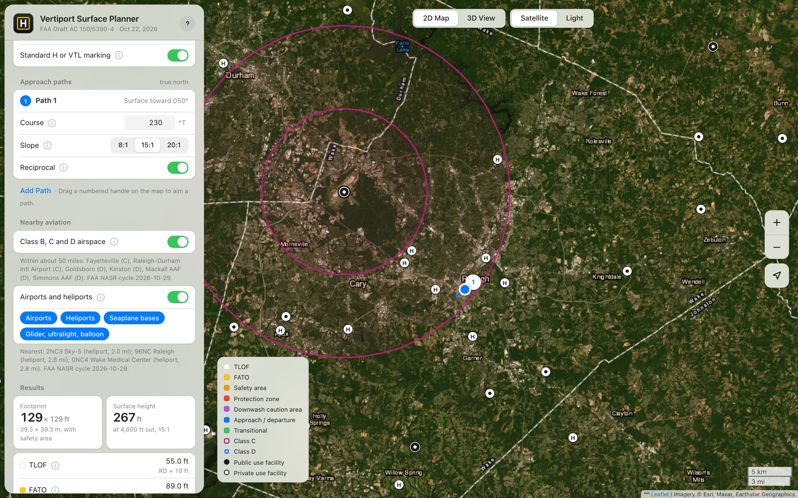

The example pad sits inside the Smith Reynolds Class D surface area, so Notes flags it. In 3D View each airspace area is a block from its floor to its ceiling, labeled on the side nearest the pad. Turning the switch on in 3D View pulls the camera back to show the airspace; the **Airspace** button at the bottom does the same later.

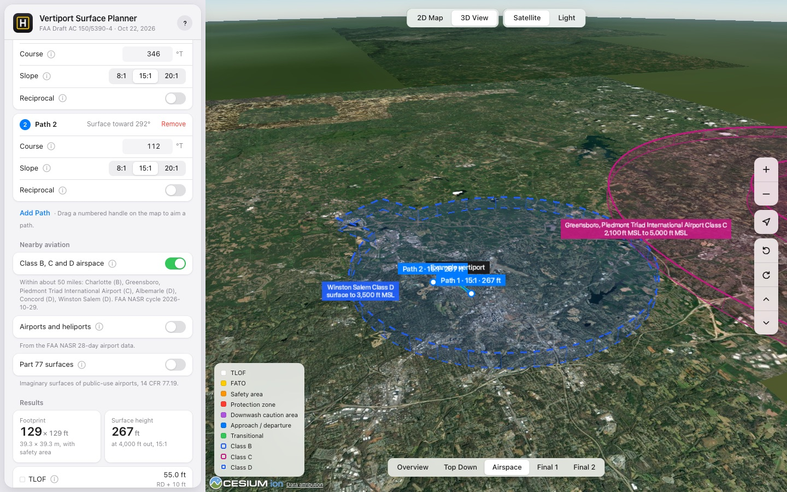

Both layers come from the FAA's NASR 28-day subscription and are built into the planner, so they work offline. The cycle date shows under each switch. The FAA updates NASR every 28 days, so check the current sectional chart before relying on it.

## Part 77 surfaces

The **Part 77 surfaces** switch draws the imaginary surfaces of 14 CFR 77.19 for every public-use airport within 20 miles: the primary surface along each runway, the approach surfaces off each end, the 7:1 transitional surfaces, the horizontal surface 150 ft above the airport, and the 20:1 conical surface beyond it. An object that rises through any of them is an obstruction to air navigation under 14 CFR 77.17.

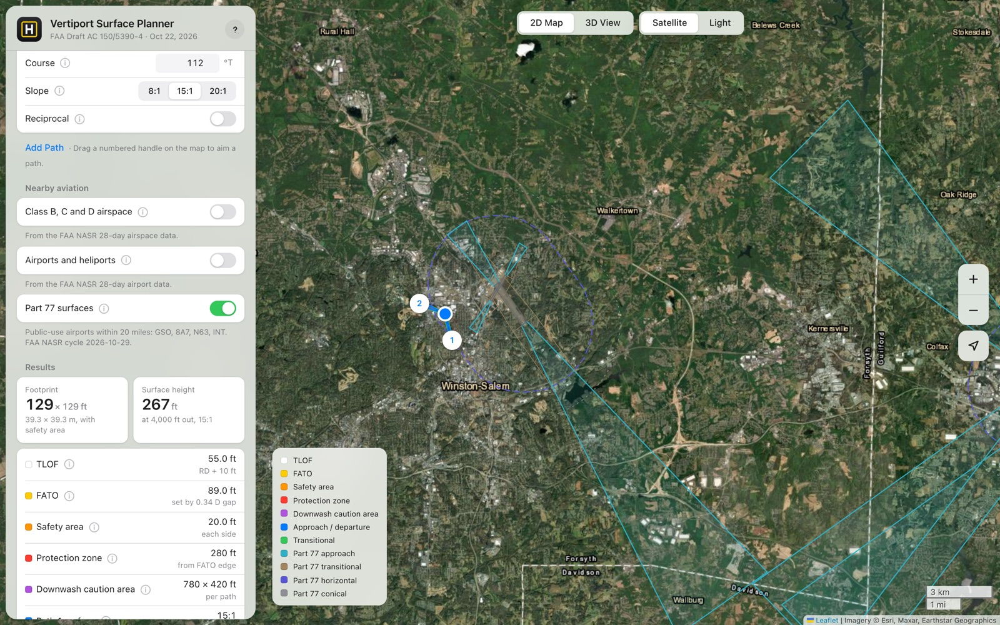

The FAA does not publish these surfaces as map data, but it does publish everything needed to build them. Each runway end in the FAA's NASR records carries its Part 77 category (utility or larger, visual, nonprecision or precision), along with its position and elevation. The planner applies the 77.19 dimensions to those records. Notes reports the lowest surface over the pad: at the example site, that is the Smith Reynolds horizontal surface at 1,119 ft MSL, 139 ft above the ground.

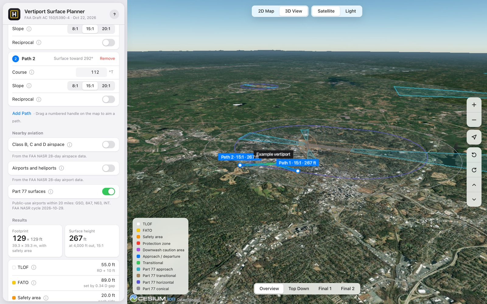

Two simplifications: runway ends with no category in NASR are drawn as utility visual (the smallest case), and the transitional surfaces stop at the horizontal surface, leaving out the extra 5,000 ft beside precision approaches. The surfaces are included in the KML and GeoJSON exports while the switch is on. For a real project, the FAA's obstruction evaluation (Form 7460-1) and the airport's Airport Layout Plan govern.

## Pad markings

The planner draws the TLOF markings from Figure 4-15 of the draft AC. Every heliport and vertiport uses the same H, 10 ft tall, in the center of the TLOF; there is no separate "V" symbol. When the design aircraft is powered lift, "VTL" goes in the top-left corner. A box in the lower-right corner shows the weight limit in thousands of pounds over the rotor diameter. All of them read upright to a pilot flying Path 1, so on a north-up map they may look rotated. Zoom in all the way to see them.

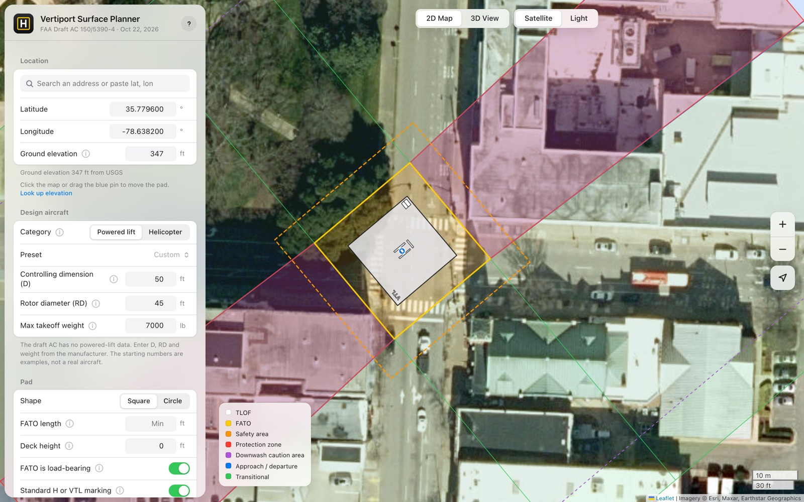

Turning off **Standard H or VTL marking** removes them and adds 10 ft to the safety area, as the AC requires.

## Open your export in Google Earth or GIS

To see what an export looks like before you make one, open the samples in [`docs/examples`](docs/examples).

### Google Earth

You don't need to install anything. Google Earth on the web opens the KML file directly:

1. Go to https://earth.google.com and sign in with any Google account.
2. Click **Local KML editor** at the bottom left, then **Open KML/Z from device**, and pick the `.kml` file.

The file stays on your computer; nothing is uploaded to your Google account.

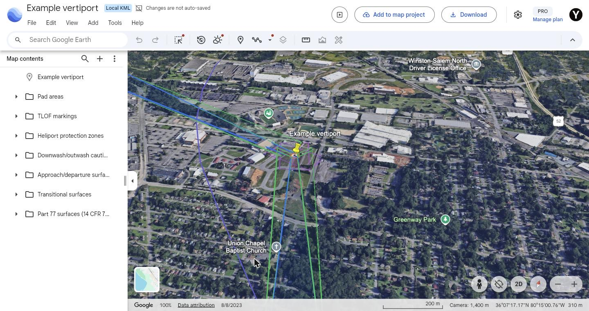

If you prefer the desktop app, Google Earth Pro is a free download from Google. Choose File, then Open, and pick the `.kml` file. Google Earth Pro also fills the sloped surfaces with color; the web version mostly shows their outlines.

The pad areas lie on the ground. The approach and transitional surfaces float at their true altitude, so tilt the view to see them. If a surface starts above or below the pad, the ground elevation in the planner differs from Google Earth's terrain; type Google Earth's elevation into the planner and export again.

### QGIS

Drag the `.geojson` file onto the map. QGIS gives every shape the same random color at first. To color it like the planner, download [`vertiport-surfaces.qml`](docs/qgis/vertiport-surfaces.qml), then right-click the layer, choose **Properties**, then **Style**, and at the bottom pick **Style**, then **Load Style**, and choose that file.

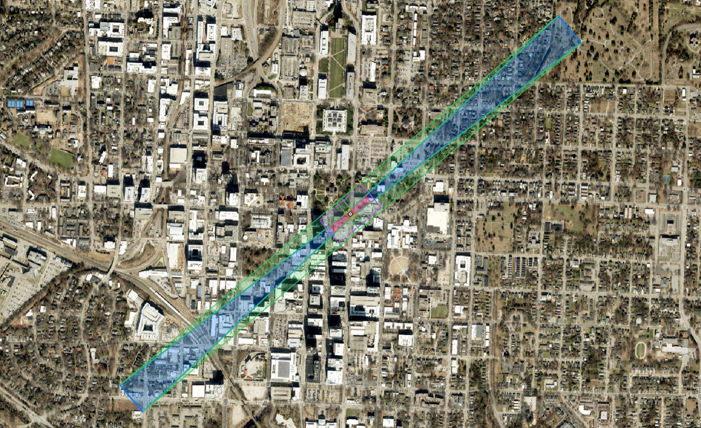

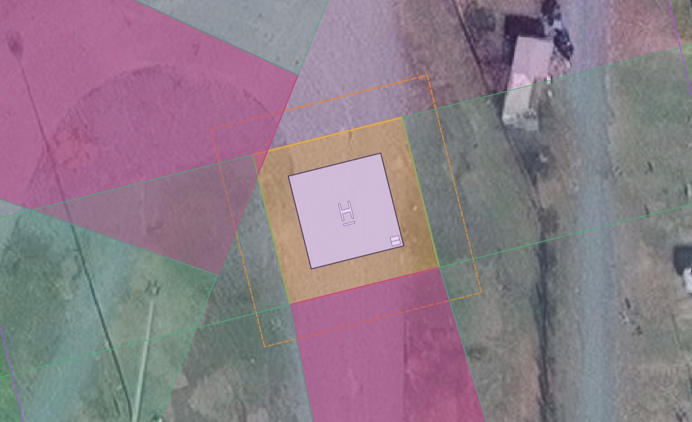

### ArcGIS Pro

Run the **JSON To Features** geoprocessing tool on the `.geojson` file.

Coordinates are WGS 84 longitude and latitude (EPSG:4326). Heights are meters above mean sea level.

## What the planner draws

| On the map | What it is | Size rule | Draft AC |
|---|---|---|---|
| White square | TLOF, the touchdown and liftoff area | RD + 10 ft; 20% larger on an elevated pad whose FATO can't carry the aircraft | 4.2.1.4 |
| Yellow square | FATO, the final approach and takeoff area | The larger of 1.5 D and the TLOF plus 0.34 D on every side | 4.3.1.4 |
| Orange dashed line | Safety area around the FATO | 0.28 D, at least 20 ft; 10 ft more without the standard H marking | 4.4.1.4 |
| Red | Heliport protection zone | The first 280 ft under each approach surface | 4.5.1 |
| Purple dashed | Downwash caution area, where rotor wash may reach 34.5 mph | 780 by 420 ft per path, for aircraft of 7,000 lb or less | 4.6.1 |
| Blue | Approach and departure surface | Starts at the FATO edge, widens to 500 ft at 4,000 ft out; 8:1 or flatter for helicopters, 15:1 or flatter for powered lift | 4.7.1.1 |
| White, outlined | TLOF markings: the H, the "VTL" and the size/weight box | H 10 ft tall by 6 ft 8 in wide | 4.8.1.1, Figure 4-15 |
| Green | Transitional surfaces | Rise at 2:1 from the sides of the approach surface, out to 250 ft from its centerline | 4.7.1.1 |

Sites above 1,000 ft elevation get a longer FATO, read from Figure 4-4 of the draft AC to within about 5 ft. Helicopter presets come from Appendix E, Table E-1.

Not drawn yet: curved approaches, hospital lateral extensions, taxiways and their caution areas, and parking positions.

The FAA evaluates obstacles only against the 8:1 surface under 14 CFR Part 77. A flatter 15:1 or 20:1 surface is useful for planning, but the FAA does not protect it or use it for charting.

## If something doesn't work

**The map is blank or gray.** Your network may block a map service. Ask IT to allow these sites: `server.arcgisonline.com`, `elevation3d.arcgis.com`, `cdn.jsdelivr.net`, `cdnjs.cloudflare.com`, `epqs.nationalmap.gov`, `api.open-meteo.com` and `photon.komoot.io`. The **Data sources** link at the bottom of the sidebar lists what each one provides.

**The 3D view says it is unavailable.** You opened the downloaded file from your computer. Use the online link instead.

**3D buildings don't appear.** Paste a Cesium ion token in the sidebar (see above). If you already did, the token may have been copied incompletely; copy it again.

**The ground elevation is wrong.** Type the surveyed elevation in the Ground elevation box. The lookup uses USGS data in the United States and coarser Open-Meteo data elsewhere.

**Search doesn't find the address.** Add the city and state, or paste latitude and longitude instead.

## Terms used

| Term | Meaning |
|---|---|
| AC | Advisory Circular, the FAA's guidance document |
| D | Controlling dimension: the smallest circle around the whole aircraft |
| RD | Rotor diameter: the smallest circle around all the lifting rotors or propellers |
| MTOW | Maximum takeoff weight |
| TLOF | Touchdown and liftoff area |
| FATO | Final approach and takeoff area |
| HPZ | Heliport protection zone |
| DCA | Downwash and outwash caution area |
| 8:1, 15:1 | Surface slope: 1 ft up for every 8 or 15 ft out |
| °T | Degrees from true north |

## Important

This is a planning sketch based on a draft standard. It is not an FAA airspace determination, a design approval, or a substitute for an engineer's review.

## For developers

The whole planner is one HTML file, `tool/vertiport-surfaces.html`. The geometry is a set of pure functions in the `<script id="geometry">` block, with no page dependencies, so it can be tested in Node. It uses Leaflet for the 2D map and CesiumJS for the 3D view, both loaded from public CDNs.

The airspace, airport and runway (Part 77) layers live in `tool/data/`. To refresh them for a new NASR cycle, download the subscription from https://www.faa.gov/air_traffic/flight_info/aeronav/aero_data/NASR_Subscription/ and run:

```
scripts/build_airspace.sh <class_airspace_shape_files.zip> <cycle date>
python3 scripts/build_facilities.py <DD_Mon_YYYY_CSV.zip> <cycle date>
```

`build_facilities.py` writes both `facilities.js` and `runways.js`.

The airspace script needs GDAL (`ogr2ogr`). The current files are from the October 29, 2026 cycle.

To serve it on your own network:

```
python3 -m http.server 8080 --directory tool
```

`source/faa_draft_ac_150-5390-4/` holds the draft AC, the FAA's industry letter, its comment matrix and a text extract, downloaded from faa.gov on November 4, 2026.

## License

The planner is source-available under the [PolyForm Noncommercial License 1.0.0](LICENSE.md). It is not "open source" in the OSI sense, because commercial use is not allowed.

You may use, change and share it for any noncommercial purpose. The license also allows use by government institutions, public safety and health organizations, schools, charities and public research organizations, whatever their funding.

Commercial use needs a separate license. That includes paid consulting or engineering work, use inside a for-profit company, and use in a commercial product. To ask about a commercial license, fill out the [commercial license request form](https://docs.google.com/forms/d/e/1FAIpQLSf1xf1FYvdN0Jw-cdIcSiQatTBELTr2MrMmcFuTI27Qir7J-w/viewform). It takes about two minutes, and Basil replies by email.

The files in `source/` are U.S. government works and are not covered by this license. Map tiles, terrain, elevation and search come from third-party services, each under its own terms.

Required Notice: Copyright 2026 Basil Yap (https://github.com/basilbuildsai)
